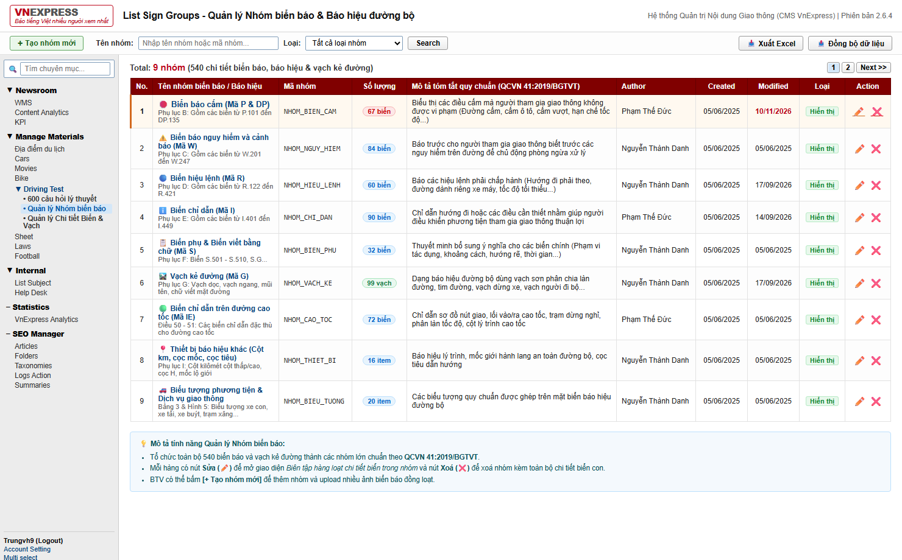
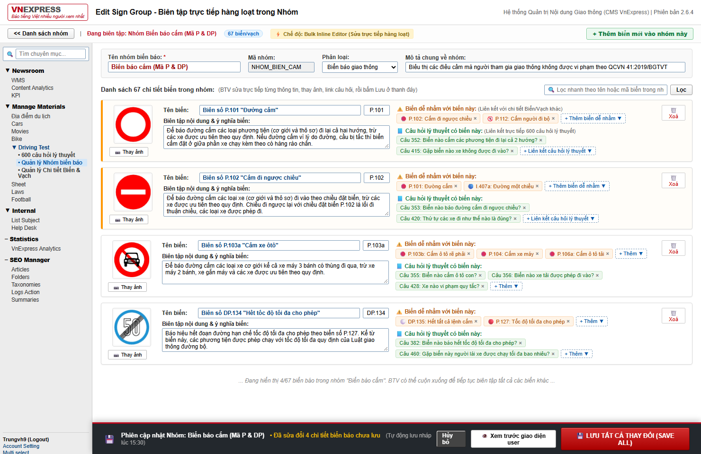
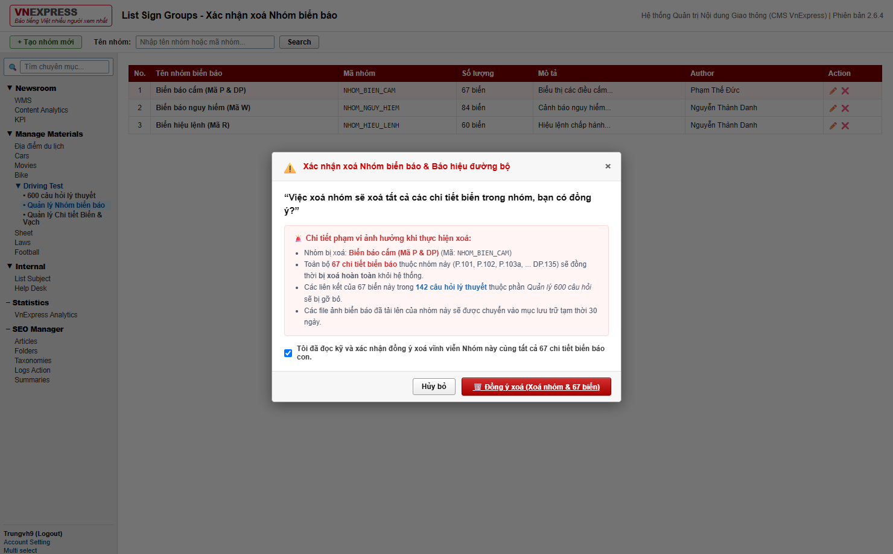

# Hệ thống Quản lý Nhóm Biển Báo & Vạch Kẻ Đường (VnExpress CMS)

Hệ thống quản lý nội dung chuyên sâu cho Chuyên mục **Luật Giao thông & Báo hiệu đường bộ** của VnExpress. Hệ thống được thiết kế để giải quyết bài toán biên tập quy mô lớn (~540 biển báo, báo hiệu & vạch kẻ đường) với tốc độ cao, hỗ trợ chỉnh sửa hàng loạt và liên kết thông minh với module 600 câu hỏi lý thuyết sát hạch lái xe.



---

## 🚀 Tính năng nổi bật

### 1. Tổ chức dữ liệu theo Nhóm lớn
Toàn bộ ~540 biển báo và vạch kẻ đường được chia thành các nhóm lớn trực quan:
- **Biển báo cấm** (Mã P & DP): 66 biển
- **Biển báo nguy hiểm và cảnh báo** (Mã W): 83 biển
- **Biển hiệu lệnh** (Mã R): 54 biển
- **Biển chỉ dẫn** (Mã I): 132 biển
- **Biển phụ và biển viết bằng chữ** (Mã S): 24 biển
- **Vạch kẻ đường** (Mã G): 96 vạch
- **Biển chỉ dẫn trên đường cao tốc** (Mã IE): 50 biển
- **Thiết bị báo hiệu khác** (Cột km, cọc tiêu, cọc mốc): 6 item
- **Biểu tượng phương tiện & dịch vụ công cộng**: 29 biểu tượng

---

### 2. Cấu trúc 6 trường thông tin chuẩn cho từng Biển/Vạch
Mỗi chi tiết biển báo bao gồm đầy đủ 6 trường thông tin:
1. **Tên biển**: Tên chuẩn quy chuẩn và mã hiệu (ví dụ: `Hình B.1 - Biển số P.101 - Đường cấm`).
2. **Ảnh biển**: Hiển thị ảnh thực tế với nút `[📷 Thay ảnh]` cho phép thay thế tức thì.
3. **Title biển**: Tiêu đề tối ưu SEO và tiêu đề hiển thị bài viết chi tiết.
4. **Nội dung text**: Quy định kỹ thuật, ý nghĩa hiệu lực và hướng dẫn thi hành theo QCVN 41:2019/BGTVT.
5. **Các biển liên quan (dễ nhầm lẫn)**: Liên kết hai chiều giữa các biển/vạch dễ gây nhầm lẫn với tính năng Live Autocomplete từ toàn bộ kho biển.
6. **Các câu hỏi lý thuyết liên quan**: Liên kết trực tiếp với các câu hỏi sát hạch trong kho **600 câu hỏi lý thuyết lái xe** qua tính năng Live Search.



---

### 3. Tối ưu năng suất biên tập (Bulk Editor & Bottom Pin Bar)
- **Inline Bulk Editor**: BTV click sửa nhóm sẽ hiển thị toàn bộ các biển/vạch trong nhóm trên cùng một màn hình làm việc, cho phép chỉnh sửa đồng thời mà không phải mở từng trang con.
- **Thanh Bottom Pin Bar**: Luôn ghim ở đáy màn hình với nút **`[💾 LƯU TẤT CẢ THAY ĐỔI (SAVE ALL)]`**, lưu toàn bộ cập nhật (tên nhóm, chi tiết biển, ảnh mới, tag liên kết) trong một phiên duy nhất.
- **Thêm nhóm mới (Bulk Upload)**: Hỗ trợ kéo thả cùng lúc nhiều ảnh, tự động sinh form chi tiết cho từng ảnh để BTV điền thông tin và lưu đồng loạt.
- **Xoá nhóm an toàn**: Modal cảnh báo xác nhận với thông điệp:
  > *"Việc xoá nhóm sẽ xoá tất cả các chi tiết biển trong nhóm, bạn có đồng ý?"*
  Xoá đồng thời nhóm và toàn bộ biển con khỏi hệ thống.



---

### 4. Quản lý từng Chi tiết Biển / Vạch riêng (Single Item CRUD)
Bên cạnh chế độ sửa hàng loạt theo nhóm, hệ thống cung cấp màn hình quản lý chuyên biệt cho từng chi tiết biển/vạch riêng lẻ:
- **Tra cứu & Lọc nhanh:** Bộ lọc theo nhóm trực thuộc, ô tìm kiếm thời gian thực (tên biển, mã hiệu, title SEO, quy chuẩn), phân trang hiển thị thông minh.
- **Sửa riêng 1 biển (Edit Item):** Giao diện tập trung chỉnh sửa riêng lẻ 1 biển bất kỳ với preview ảnh lớn, nút thay ảnh tức thì, cập nhật title SEO, văn bản quy chuẩn, liên kết biển liên quan và câu hỏi sát hạch trong kho 600 câu.
- **Thêm mới 1 biển (Create Item):** Nút `[+ Tạo chi tiết biển mới]` cho phép BTV khởi tạo nhanh 1 biển/vạch đơn lẻ và chọn nhóm trực thuộc.
- **Xoá 1 biển (Delete Item):** Icon ❌ kèm modal xác nhận xoá an toàn, tự động đồng bộ lại số lượng biển trong nhóm.

---

## 📁 Cấu trúc thư mục

```text
quan-ly-bien-vach/
├── public/                                # Thư mục Static Files được Vercel và máy chủ phục vụ trực tiếp
│   ├── index.html                         # Giao diện SPA chuẩn phong cách VnExpress CMS
│   ├── style.css                          # Bộ nhận diện giao diện VnExpress CMS
│   ├── app.js                             # Xử lý tương tác, bulk edit, live search
│   └── anh/                               # 540 file ảnh quy chuẩn trích xuất từ QCVN 41:2019/BGTVT
├── api/
│   └── index.js                           # Vercel Serverless Function & RESTful API Handler
├── data/
│   ├── db.json                            # Database JSON lưu trữ 9 nhóm, 540 biển, 600 câu hỏi
│   └── seed.js                            # Script khởi tạo & đồng bộ dữ liệu
├── demo-giao-dien-quan-ly-nhom-bien/      # Ảnh chụp màn hình giao diện (Screenshots 4K/HD)
│   ├── 01_danh_sach_nhom_bien_bao.png
│   ├── 02_sua_nhom_bulk_editor.png
│   ├── 03_sua_nhom_autocomplete_link.png
│   ├── 04_them_nhom_moi_bulk_upload.png
│   └── 05_xac_nhan_xoa_nhom_modal.png
├── server.js                              # Máy chủ Node.js phát triển cục bộ (Local Server)
├── vercel.json                            # Cấu hình tự động định tuyến Vercel Serverless & Static
├── QCVN41_2019_-Bien-bao-hieu-duong-bo.doc # File văn bản gốc Quy chuẩn kỹ thuật quốc gia
├── package.json
└── README.md
```

---

## ⚡ Hướng dẫn cài đặt & Khởi chạy

### 1. Khởi chạy cục bộ (Localhost):
Yêu cầu hệ thống: [Node.js](https://nodejs.org/) phiên bản 16 trở lên (Zero external dependencies).

```bash
# Khởi động máy chủ cục bộ
npm start
# hoặc
node server.js
```
Truy cập ứng dụng tại trình duyệt: **`http://localhost:3000`**

### 2. Triển khai lên Vercel:
Dự án đã tích hợp sẵn file cấu hình `vercel.json` và cấu trúc chuẩn cho Vercel Serverless:
- Thư mục `public/` chứa toàn bộ frontend tĩnh và 540 ảnh biển báo được Vercel CDN phân phối toàn cầu.
- Thư mục `api/index.js` tự động xử lý toàn bộ các API `/api/groups`, `/api/signs/all`, `/api/questions/search` dưới dạng Serverless Functions.
- Mỗi khi push code lên GitHub, Vercel sẽ tự động build và deploy trong vài giây.
